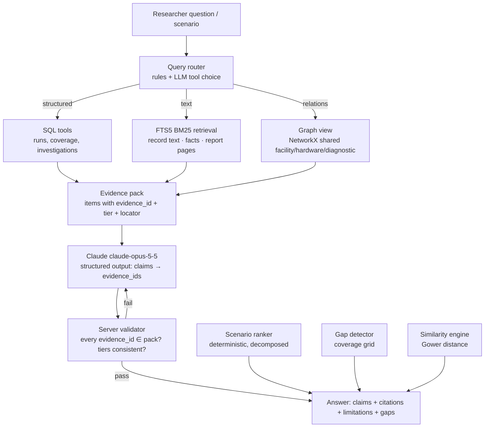

# FIREWISE — AI Architecture

> **Readiness audit 2026-11-13:** §6 scenario ranking (weighted score) is superseded by lexicographic evidence counts (`FINAL_API_CONTRACT.md` §3). The streamed `/ask` is superseded by a non-streamed validated response (§4 there). See `FINAL_READINESS_AUDIT.md` and `CHANGELOG.md`.

**Principle: the LLM never holds facts. It selects, compares and explains evidence that the retrieval layer
hands it, and every sentence it emits must cite an evidence ID the server can resolve.** Most of the
"intelligence" is deterministic code over the run table: ranking, similarity, gaps. The LLM is the explainer,
not the oracle.

---

## 1. Components and what each actually does


---

## 2. Scientific document intelligence
| Input | Method | Status |
|---|---|---|
| PSI investigation records (24) | JSON fields copied verbatim and tagged `PSI-rec` | ✓ done (`build_records.py`) |
| Experimental tables (22 CSV, 20 investigations) | per-investigation normalizers with flags | ✓ done (`build_runs.py`) |
| Reports / science docs (PDF, about 100) | `pdftotext -layout` per page → `passage` rows with `pdf:<sha256>#p<N>`; scanned pages flagged, OCR P2 | P0 for the ~10 key reports, P1 for the rest |
| Tables inside PDFs | **not** auto-extracted for P0. Hand-curate the few numbers needed into `curated_facts.json` with page locators | deliberate |
| Figures and images | not interpreted by the LLM in P0. P1 showcase: decode one ACME HOBJ frame and the Saffire calibration grid | optional |
| Citations | evidence IDs resolve to a PSI URL + field, a CSV file + row, or a PDF + page | ✓ schema |

---

## 3. Scientific RAG
- **Units of retrieval (`passage` FTS5):** investigation text fields; curated facts; one generated sentence per run
  group (e.g. "FLEX: 22 methanol/N₂ tests at ≤15% O₂, all ended in extinction", verified); PDF pages.
- **Retrieval levels:**

| Level | Example | Mechanism |
|---|---|---|
| Investigation | "Which investigations studied smoke?" | FTS over record text + `fuel_class` filter |
| Experiment / run | "FLEX tests at 0.7 atm with helium" | **SQL tool**, not text search |
| Concept | "cool flame", "opposed flow" | FTS with a small synonym map (cool flame ↔ low-temperature, opposed ↔ counter-flow) |
| Variable | "O₂ between 30 and 36%" | SQL range filter on normalized fields |

- **Grounding contract:** structured output (`output_config.format`) with this schema:
  ```json
  {"claims":[{"text":"…","tier":"measured|reported|literature|interpretation","evidence_ids":["run:FLEX-…","PSI-69#objective"]}],
   "limitations":["…"], "related_investigations":["PSI-39"], "follow_up_questions":["…"]}
  ```
  The server then enforces the contract:
  - It drops any claim with no evidence ID, or with an ID outside the pack. If more than one claim fails, it
    re-asks once.
  - `tier = measured` is allowed only when every cited item's status is measured.
  - `interpretation` claims are rendered visually distinct.
- **Why not the API's native Citations feature:** it is incompatible with `output_config.format`, and our
  evidence is structured rows rather than prose documents. Our own evidence IDs give row-level provenance.
- **Model use (Claude API, Python SDK):**
  - `claude-opus-5-5` with adaptive thinking (the default)
  - effort `medium` for Q&A, `low` for query routing
  - prompt caching on the frozen system prompt + investigation catalog (about 15k tokens, stable prefix)
  - server-side refusal fallback enabled (`fallbacks: "default"`)
  - streaming for long answers
  - About 150 demo and validation queries at ~20k input tokens each is roughly 3M input tokens, which is low
    cost. Use the Batch API for the validation run.

---

## 4. Knowledge graph: derived, not stored
- **Nodes:** Investigation · Facility (CIR, MSG, Cygnus, ISS cabin) · Insert (ACME, MDCA, MSG duct) · Hardware
  item · Diagnostic (P-Trak, DustTrak, radiometer, colour camera…) · Fuel · FuelClass · Publication ·
  ConditionBand (O₂ band, P band) · Scenario.
- **Edges (typed, each with evidence_id):** `uses_facility`, `uses_insert`, `measures_with`, `burns`,
  `has_class`, `cites`, `related_to` (PSI listing), `continues` (FLEX → CFI test numbering), `qualified_for`
  (DAFT → SAME), `covers_band`.
- **Does the graph materially improve reasoning over vector retrieval?** For this corpus, no. With 24
  investigations every relational question is a SQL join. Its value is **explanation and exploration**: show
  *why* two experiments are linked (the path), and let users find shared hardware visually. It stays a NetworkX
  view rendered with Cytoscape.js (P1), not a database.

---

## 5. Experiment similarity engine (transparent)
**Unit:** investigation profile, or run group = (investigation, fuel class, diluent, configuration).

**Distance:** Gower-style weighted mean over **comparable features only**.

| Feature | Type | Per-feature distance |
|---|---|---|
| fuel_class, facility, insert, burner/sample geometry, diluent | categorical | 0 if equal, else 1 |
| fuel identity | categorical, hierarchical | 0 same fuel · 0.5 same family (alkanes) · 1 |
| O₂, pressure, flow | interval | 1 − overlap(Ia, Ib) / union(Ia, Ib) |
| diagnostics | set | 1 − Jaccard |
| gravity | categorical | 0/1 |

**Rules:**
- Missing on either side means the feature is **excluded**, and the UI reports "*compared on 4 of 9 features*".
- **Incompatibility guards** add a hard flag (not a distance): normal vs inverse flames, smoke source vs
  flame, dust vs smoke, emulator vs real solid.
- The UI always shows the per-feature contributions. The score is labelled "condition similarity". **It is
  never called scientific equivalence.**
- Weights are user-adjustable, with defaults (conditions 0.5, configuration 0.3, diagnostics 0.2).

---

## 6. Scenario ranking (the challenge's "rank")
**Presets:**

| Scenario | O₂ | Pressure | Gravity | Source |
|---|---|---|---|---|
| ISS | 21% | 14.7 psia | µg | ISS |
| Exploration atmosphere | 34% | 8.2 psia | — | FM2 poster |
| Moon base | ≥30% | ≤10.2 psi | 0.16 g | challenge text |
| Mars | — | — | 0.38 g | — |
| Pressurized rover | — | — | — | user-set |

**Relevance score per investigation:**
`score = Σ wᵢ·cᵢ`, with each component in [0, 1] and **shown separately**:

| Component | Definition |
|---|---|
| c₁ atmosphere match | fraction of the investigation's runs whose documented O₂ and P fall inside the scenario window. Weights by status: measured 1.0 · derived/reported 0.8 · specified 0.6 |
| c₂ material relevance | scenario-specific weights by fuel class. Habitat fire: solid 1.0 · solid-emulator 0.8 · liquid 0.6 · gas 0.4 · smoke source 0.7 (detection) |
| c₃ flow relevance | overlap with the user-set ventilation window |
| c₄ outcome richness | fraction of runs with measured outcomes (extinction, spread, burn time, cool flame) |
| c₅ data availability | class A 1 · B 0.8 · C 0.5 · D 0.2 · E 0 |
| c₆ gravity | µg = 1 for spacecraft. For partial-g scenarios, **all investigations get the badge "bracketing only: no partial-g data"** and paired µg/1g evidence (Saffire-II) gets a bonus |

Label: "**Evidence relevance**, not fire risk." Ties are broken by number of documented runs.

---

## 7. Scientific reasoning workflows
Each canonical question maps to a deterministic plan before the LLM writes prose:

| Question | Plan |
|---|---|
| "Which experiments give evidence for O₂-enriched conditions?" | SQL: runs with O₂ > 23% grouped by investigation and status, plus BRE impact text, plus the gap note (no solids) |
| "How do BASS and Saffire configurations differ?" | similarity engine feature table + record text (MSG fan vs Cygnus duct; sizes; flow) + incompatibility notes |
| "What instrumentation was shared between SAME and DAFT?" | graph path DAFT -qualified_for→ SAME via P-Trak + PSI-47 objective quote + fact F04 |
| "What evidence exists about partial gravity?" | coverage: 0 PSI runs · facts X01/X02 (literature) · Saffire-II µg/1g bracket · "not defensible" list |

**Output sections are always:** Evidence (measured/reported) · Literature · Interpretation · Limitations ·
Gaps · Sources.

---

## 8. Research-gap discovery (what we can honestly claim)
- **Method:** enumerate the cells of gravity × fuel class × O₂ band × P band (+ flow band). For each, count
  documented runs by status. Cells with 0 runs are gaps, and cells where only literature exists are "evidence
  outside PSI".
- **Ranking gaps by habitat relevance:** gap cells inside scenario windows first.
- **Current top gaps (from `derived/coverage_summary.json`):**
  - solids × elevated O₂: 0 runs
  - solids × documented pressure: 0
  - partial g: 0
  - flaming smoke: 0
- **This is gap *mapping*, not autonomous discovery.** The platform says where PSI has no documented runs;
  scientists decide whether a gap matters.

---

## 9. Predictive modeling: feasibility decisions
| Target | Decision |
|---|---|
| FLEX end mode (extinction/disruption/completion) | **P1 optional.** Multinomial logistic regression + shallow tree on fuel, diluent, O₂, P, d₀; grouped CV by test day; report macro-F1 and a confusion matrix; applicability domain = FLEX's convex hull; refuses outside it |
| FLEX extinction diameter | P2 exploratory regression with residual plots |
| CFI-G cool flame | **No** (7 positives; blanks ≠ negatives) |
| Solid spread / fire growth | **No** (13 Saffire burns; no conditions for BASS) |
| Partial-g anything | **No.** Out of the claims entirely |
| Gradient boosting / deep models | **No**: no data volume to justify them; less transparent |

---

## 10. Failure modes and guards
| Risk | Guard |
|---|---|
| LLM states an unsupported number | the validator rejects claims without evidence IDs; numbers in claims are cross-checked against cited items (regex number match) |
| Proposal conditions confused with tested ones | record text tagged `PSI-rec:objective` is never tier `measured`; CFI-G planned-vs-tested fact surfaced |
| Similarity mistaken for equivalence | wording, plus feature breakdown, plus incompatibility flags |
| Gap = "never measured" | wording: "not documented in PSI tables" |
| Prompt injection via PDF text | PDFs are data; the system prompt says retrieved text is evidence, never instructions; no tools with side effects |
