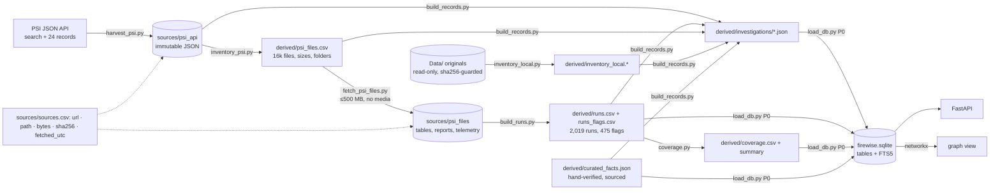
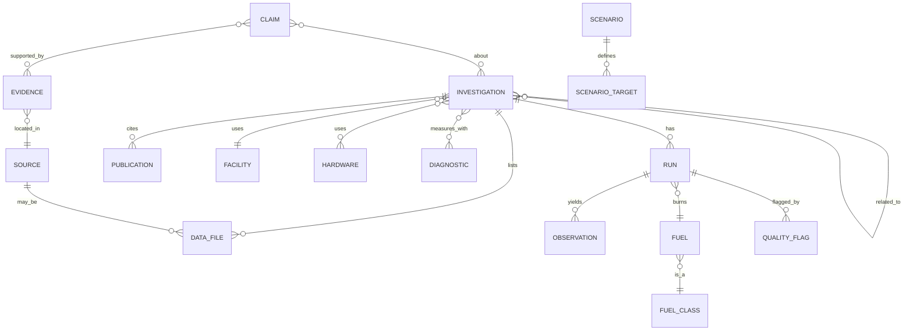

# FIREWISE — Data Architecture

> **Readiness audit 2026-11-13:** The schema (§4) is superseded by `FINAL_DATA_CONTRACT.md`: `row_key` primary key, `row_granularity`, `o2_context` and `gravity_regime`, with no orphan flags. See `FINAL_READINESS_AUDIT.md` and `CHANGELOG.md`.

*The scope is deliberately small: 24 investigations, about 2,000 runs, about 8 GB of files. **SQLite** (one file,
relational + FTS5 full-text) is the store. The knowledge graph is a *derived view* built in memory with NetworkX.
No Postgres, no Neo4j, no vector DB unless the validation set shows BM25 retrieval failing.*

---

## 1. Pipeline (every step runs today except `load_db.py`, the first P0 build task)


**Immutability rules:**
- `Data/` and `sources/` are never edited. `derived/` is fully regenerable.
- Every fetched file has a manifest row in `sources/sources.csv`.
- `checksum_data.py --verify` guards `Data/`.

---

## 2. Levels of the data model (as required)
| Level | Entity | Example | Source |
|---|---|---|---|
| 1. Investigation | `investigation` | PSI-69 FLEX | PSI record |
| 2. Experiment configuration | `configuration` (facility + insert + burner/sample type) | CIR/MDCA free droplet; ACME porous sphere | PSI record + curated |
| 3. Test run | `run` | FLEX-114-C11M201 (Methanol, 0.2 O₂, P missing) | PSI experimental table |
| 4. Measurement / observation | `observation` (per run: extinction diameter, burn time, cool flame yes, µg burn length) | run → `extinction_d = 0.89 mm (measured)` | PSI table columns, telemetry (P1) |
| 5. Publication-level conclusion | `claim` | "Cool flames only for 30% n-butane at X_O₂ ≈ 0.39, ≈2 bar" | curated fact + citation |

---

## 3. Entity-relationship diagram

`EVIDENCE` is the provenance join. Each row points to a `SOURCE` (PSI record field, table row, PDF page or URL)
with a *locator*, so every value in the UI can open its origin.

---

## 4. SQLite schema (P0)
```sql
CREATE TABLE investigation (
  id TEXT PRIMARY KEY,                -- 'PSI-69'
  acronym TEXT, title TEXT, doi TEXT, psi_url TEXT, license TEXT,
  project_type TEXT, platform TEXT, facility TEXT, hardware TEXT,
  sub_research_area TEXT, start_date TEXT, end_date TEXT,
  objective TEXT, hypothesis TEXT, approach TEXT, research_impacts TEXT,   -- verbatim PSI-rec
  data_class TEXT CHECK (data_class IN ('A','B','C','D','E')),
  n_files_listed INTEGER, listed_gb REAL, total_gb REAL, listing_complete INTEGER,
  record_json TEXT                    -- full derived/investigations/PSI-NN.json
);
CREATE TABLE run (
  run_id TEXT PRIMARY KEY, investigation_id TEXT REFERENCES investigation(id),
  date TEXT, fuel_or_material TEXT, fuel_class TEXT, geometry TEXT, diluent TEXT, gravity TEXT,
  o2_min_pct REAL, o2_max_pct REAL, o2_status TEXT,
  p_min_atm REAL, p_max_atm REAL, p_status TEXT,
  flow_min_cm_s REAL, flow_max_cm_s REAL, flow_status TEXT,
  outcome TEXT, source_file TEXT, source_row INTEGER, raw_json TEXT
);
CREATE TABLE quality_flag (run_id TEXT, investigation_id TEXT, source_file TEXT, source_row INTEGER, flag TEXT);
CREATE TABLE publication (investigation_id TEXT, title TEXT, authors TEXT, doi TEXT, status TEXT);
CREATE TABLE data_file (investigation_id TEXT, folder TEXT, file_name TEXT, bytes INTEGER, ext TEXT,
                        downloaded INTEGER, local_path TEXT, sha256 TEXT);
CREATE TABLE claim (id TEXT PRIMARY KEY, field TEXT, value TEXT, status TEXT, tag TEXT,
                    source TEXT, locator TEXT, confidence TEXT, caveat TEXT);
CREATE TABLE claim_investigation (claim_id TEXT, investigation_id TEXT);
CREATE TABLE coverage_cell (gravity TEXT, fuel_class TEXT, o2_band TEXT, p_band TEXT, runs INTEGER, investigations TEXT);
-- Retrieval: one FTS5 table over every citable text unit
CREATE VIRTUAL TABLE passage USING fts5(
  evidence_id UNINDEXED,              -- 'PSI-69#objective', 'run:FLEX-1-20CAL08', 'fact:F06', 'pdf:<sha>#p12'
  investigation_id UNINDEXED, kind UNINDEXED, text, tokenize='porter unicode61');
```

---

## 5. Value representation (JSON schema core)
Every condition or measurement leaves the pipeline in this shape:
```json
{
  "value": 0.89, "unit": "mm",
  "original": "0.89", "original_unit": "mm",
  "norm_value": 0.89, "norm_unit": "mm",
  "status": "measured | specified | derived | reported | inferred | missing",
  "source_id": "PSI-69_Experimental table_FLEX.csv", "locator": "row 2, col 'Visible flame extinction diameter; mm'",
  "confidence": "high | medium | low",
  "flags": ["…"]
}
```
`derived/runs.csv` stores the normalized fields flat. The `raw` column keeps the verbatim source row, so any
normalization can be audited.

---

## 6. Validation rules (enforced in `build_runs.py` or at DB load)
| Rule | Action |
|---|---|
| O₂ must be 0–100 % after normalization; anything over 100 with a `%` suffix is a format artifact | divide by 100, add a flag (BRE `3400%`) |
| Pressure > 0. A value of 0 is treated as missing | flag (FLEX test 114) |
| Negative flow | keep as reported, flag (SPICE) |
| Exact duplicate rows | keep, flag (SPICE ×34) |
| Chemically impossible fuel names (CH5…CH14, C2H5) | correct to CH₄/C₂H₄, flag, raw preserved |
| Unreadable cells (`�`) | missing, flag |
| Footnote and non-test rows (Saffire "Note n", "F1C1/F1C2") | excluded or typed `fuel_class = none`, flag |
| Any field without a `source_file` + `source_row` | **rejected at load** |
| Measured vs. specified | never upgraded. Envelope rows (FLEX-2) stay `specified` |

---

## 7. Units
| Quantity | Canonical | Conversions applied |
|---|---|---|
| O₂ | mole % | mole fraction × 100 (FLEX, CFI, Flame Design, CFI-G) |
| Pressure | atm | mmHg / 760 (FLEX); bar × 0.98692 (CFI-G); "1 atm" parsed (CFI) |
| Flow | cm/s | as reported. BASS-II fan-display units are **not** converted (no calibration in the table) |
| Lengths | mm / cm as reported | display-only conversion |
| Gravity | categorical: microgravity / 1g / partial-g | no numeric g in PSI |

---

## 8. Missing values
- `NULL` plus `status = 'missing'`, never 0 and never a guess.
- The UI says "**not documented in PSI table**", which differs from "not measured" (e.g., BRE pressure).
- CFI-G's "Cool flame?" blank means **not recorded**, never "no".

---

## 9. Versioning
- `sources/` is append-only, and each fetch is stamped in `sources.csv`. A newer PSI record version is saved
  next to the old one (`PSI-NN@<modifiedDate>.json`) rather than overwriting it.
- `derived/` is regenerated by the scripts, so the git commit of `scripts/` and `derived/` is the dataset
  version. `firewise.sqlite` stores `meta(build_utc, git_sha, n_runs, n_flags)`.
- PSI record `version` and `modifiedDate` are kept per investigation and shown in the UI.

---

## 10. Why this store
| Option | Verdict |
|---|---|
| **SQLite + FTS5** | **Chosen.** Zero ops, ships inside the API container, full-text BM25 built in, about 10 MB of data |
| PostgreSQL | Unnecessary for read-mostly data this size; adds hosting and migrations |
| Neo4j / graph DB | Relationships come from ~20 typed edges per investigation. NetworkX builds the graph in milliseconds from SQL |
| Vector DB (FAISS/Chroma) | Optional P1, only if BM25 recall@5 is below 0.8 on the validation set; then store embeddings in SQLite |
