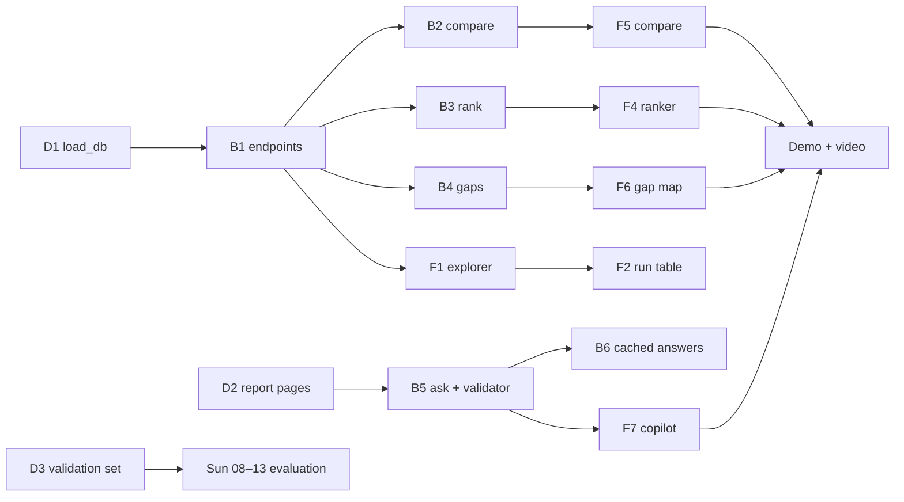

# FIREWISE — Implementation Roadmap (48 h)

> **Readiness audit 2026-11-13:** Task D0 (pipeline corrections) now precedes D1/`load_db.py` (`KICKOFF_CHECKLIST.md`). Endpoint names follow `FINAL_API_CONTRACT.md`. **Eligibility gate: `OPEN_DECISIONS.md` D1.** See `FINAL_READINESS_AUDIT.md` and `CHANGELOG.md`.

**Window:** submission opens Sat **Nov 14, 09:00** and closes Sun **Nov 15, 23:59** (local).
**Strategy:** a complete end-to-end path first (data → API → 5 screens → demo), then the differentiators.
Feature freeze is Sun 18:00.

> ⚠️ **Check the Space Apps 2026 rules on pre-event work** before the kickoff. Already done before the event:
> research, data harvesting, the normalization scripts and these documents. App code (API and web) starts at
> kickoff. If the rules limit pre-event code, declare the data pipeline as preparatory open-data work in the
> submission.

---

## 0. Already complete (pre-event, verifiable)
| Item | Evidence |
|---|---|
| Local audit (7 files, 996 members, sha256 guard) | `derived/inventory_local.*`, `derived/data_sha256.txt` |
| PSI harvest (24 of 24 records) + file inventory (16k files) | `sources/psi_api/`, `derived/psi_*.csv` |
| 22 experimental tables → 2,019 run rows, 475 flags | `derived/runs.*` |
| Coverage / gap grid | `derived/coverage*` |
| 24 evidence records + 21 curated facts | `derived/investigations/`, `derived/curated_facts.json` |
| Telemetry and documents download (≈7.5 GB, resumable) | `sources/psi_files/` (in progress) |
| 10 planning documents | `docs/` |

---

## 1. Team allocation
| Role | Owner | Owns |
|---|---|---|
| **A — Science & Data lead** | person 1 | `load_db.py`; key-report page extraction; curated facts; validation set; scientific review of every screen and answer; demo narrative and pitch |
| **B — Backend & AI** | person 2 | FastAPI, rank/similarity/gaps modules, `/ask` (retrieval, Claude call, validator), tests, deployment of the API |
| **C — Frontend & Viz** | person 3 | Next.js app, Plotly charts, comparison UI, gap heatmap, Copilot UI, web deployment, demo video |

With **2 people**, A+C merge: A takes Mission Control and the Gap Map, and B takes the Copilot UI.

---

## 2. Timeline
| When | A (science/data) | B (backend/AI) | C (frontend) | Exit criterion |
|---|---|---|---|---|
| Sat 09–11 | `load_db.py` → `firewise.sqlite`; **freeze JSON fixtures** | repo + FastAPI skeleton; `/summary`, `/investigations` from fixtures | Next.js skeleton, nav, tier-badge component | `GET /api/investigations` returns 24 records |
| Sat 11–15 | extract pages from ~10 key reports into `passage`; review records for the 15 priority IDs | `/runs`, `/compare` (similarity), `/gaps` | Explorer + Investigation page + Run Table | explorer usable end to end |
| Sat 15–20 | validation set v1 (30 Q/A); demo questions | `/rank` (scenarios), `/evidence/{id}` | Mission Control charts, Scenario Ranker with stacked bars | ranking demo works on Moon-base preset |
| Sat 20–24 | review rank and compare outputs for science errors | `/ask` v1: router, evidence pack, Claude structured output, validator | Comparison Studio, Gap Map heatmap | **first full E2E path** (question → cited answer) |
| Sun 00–08 | sleep in shifts; one person keeps downloads and tests running | | | |
| Sun 08–13 | run the validation set and fix the data issues found | `/ask` hardening, cached demo answers, tests | Copilot UI (streaming, citation chips) | recall@5 ≥ 0.8, citation correctness ≥ 0.95 |
| Sun 13–18 | P1 if green: FLEX outcome view, raw-data showcase | P1: `/graph` | P1: Cytoscape graph | **feature freeze 18:00** |
| Sun 18–22 | pitch deck, script, final science check | deploy and smoke-test the deployed URL | 7-slide deck (or ≤ 30 s video) | deployed URL passes the smoke test |
| Sun 22–23:59 | submission text, data and AI-use disclosure | buffer | buffer | submitted |

---

## 3. Task breakdown with acceptance criteria
| ID | Task | Pri | Est | Depends | Acceptance |
|---|---|---|---|---|---|
| D1 | `load_db.py` (tables + FTS5 + meta) | P0 | 2 h | derived/* | row counts equal the CSV/JSON; every run has source_file and source_row |
| D2 | Key-report page extraction (pdftotext per page) | P0 | 2 h | downloads | ≥ 10 reports, page-level `pdf:` evidence IDs resolve |
| D3 | Validation set v1 | P0 | 3 h | D1 | 30 Q/A, each with expected evidence IDs (see RISKS_AND_VALIDATION) |
| B1 | Investigations / runs endpoints | P0 | 2 h | D1 | filters on fuel class, O₂/P range |
| B2 | Similarity + `/compare` | P0 | 3 h | B1 | per-feature breakdown, "compared on k/n features", incompatibility flags |
| B3 | `/rank` with presets | P0 | 3 h | B1 | Moon-base preset ranks with decomposed components; unit tests on the weights |
| B4 | `/gaps` | P0 | 1 h | D1 | the solid × 30–36% × 0.5–0.75 atm cell returns 0 |
| B5 | `/ask` + validator | P0 | 5 h | B1, D2 | no claim without a resolvable evidence ID; scripted questions pass |
| B6 | Cached demo answers | P0 | 1 h | B5 | served when the LLM is unavailable |
| F1 | Explorer + investigation page | P0 | 4 h | B1 | verbatim objective, status chips, source links |
| F2 | Run table (changed columns) | P0 | 2 h | B1 | constant columns collapsed; flags visible |
| F3 | Mission Control | P0 | 2 h | B1, B4 | O₂ × P scatter with hover provenance |
| F4 | Scenario Ranker | P0 | 3 h | B3 | stacked component bars, "evidence relevance" label |
| F5 | Comparison Studio | P0 | 3 h | B2 | 2–4 investigations side by side |
| F6 | Gap Map | P0 | 2 h | B4 | heatmap and cell drill-down |
| F7 | Copilot UI | P0 | 3 h | B5 | streamed answer, tier sections, citation chips |
| P1a | Relationship graph | P1 | 3 h | B1 | DAFT→SAME and FLEX→CFI paths visible |
| P1b | FLEX outcome explorer / classifier | P1 | 3 h | D1 | grouped CV report; refuses outside the domain |
| P1c | HOBJ frame decode showcase | P1 | 1 h (time-box) | — | 10 frames rendered *and* validated visually, else dropped |

---

## 4. Dependencies (critical path)

---

## 5. Contingencies
| If… | Then |
|---|---|
| The LLM API is down or slow at the demo | cached validated answers (B6). All other screens are LLM-free |
| `/ask` validation keeps failing | ship deterministic templated answers for the 6 canonical intents |
| Frontend is behind on Sunday 13:00 | drop the graph and FLEX views; keep 5 P0 screens |
| Hosting fails | single Docker image on a laptop, plus the recorded demo video |
| A data error is found late | fix in the normalizer, rebuild (`build_runs → coverage → build_records → load_db`, about 1 min) |
