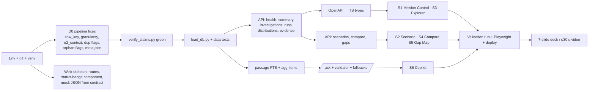

# FIREWISE — Kickoff Checklist

> ⛔ **Gate 0 (eligibility):** resolve `OPEN_DECISIONS.md` D1/D2 with the organizers **before** reusing any
> pre-event artifact. Everything below is valid in both outcomes. If pre-event artifacts may not be used, Plan B
> applies (§6).

---

## 1. Before kickoff (tonight, non-implementation)
- [ ] Send a written disclosure and question to your Local Lead / GO team (template in OPEN_DECISIONS D1).
- [ ] Decide on the running downloads (D3). Do not modify `Data/`.
- [ ] Confirm team size (2 or 3) and roles (§3).
- [ ] Obtain an Anthropic API key for the **backend host only**. Decide the spend cap (D5).
- [ ] Each teammate is registered for the **same Local Event** (required for Global Judging).
- [ ] Choose the demo format: **7 slides (recommended) or a video of ≤ 30 s** (D6).

## 2. Environment (at kickoff, ~20 min, Person B)
| Check | Command / expected |
|---|---|
| Python | `python3 --version` → 3.12.x ✓ (verified) |
| Node / npm | `node -v` → v22.22.3, `npm -v` → 10.9.8 ✓ (verified) |
| Docker | 29.4.1 ✓ (fallback deploy) |
| Git | `git init`; first commit = `.gitignore` only. **Not a repo today** |
| `.gitignore` | `Data/` `sources/psi_files/` `build/` `.env` `.venv/` `node_modules/` `__pycache__/` `*.sqlite` `derived/_superseded/` |
| Python deps | `python3 -m venv .venv && . .venv/bin/activate && pip install fastapi "uvicorn[standard]" pydantic anthropic pytest httpx` (none installed today); then `pip freeze > requirements.txt` (pinned) |
| Web | `npx create-next-app@<exact version> web --ts --tailwind --app`; add `plotly.js-dist-min`, `react-plotly.js`, `openapi-typescript` (pin exact versions in `package.json`) |
| Secrets | `ANTHROPIC_API_KEY` in the backend environment only (`.env` locally, gitignored; host env var in deploy). Never `NEXT_PUBLIC_*`. Verify: `grep -r "ANTHROPIC" web/` returns nothing |
| Integrity | `python3 -I scripts/checksum_data.py Data derived/data_sha256.txt --verify` → `OK: 7 files unchanged` |
| Claims | `python3 -I scripts/verify_claims.py .` → `derived/claims_check.json` (the numbers used by the tests) |
| SI disclosure | start `docs/SI_USE.md` at kickoff: tools, where used, which code and data are SI-assisted |

## 3. Team assignments
| Workstream | 3 people | 2 people |
|---|---|---|
| D0 pipeline corrections, `load_db.py`, curated metadata, scientific review, validation set, deck | **A** (science/data) | **A** (science/data + deck) |
| FastAPI, ranking, compare, gaps, evidence, `/ask` + validator, tests, deploy (API) | **B** (backend/AI) | **B** (backend/AI + frontend data hooks) |
| Next.js 6 screens, charts, states, Playwright smoke, deploy (web) | **C** (frontend) | split: A builds S1 + S5; B builds S2–S4 + S6 using generated types |

## 4. Dependency graph (parallel lanes)

**In parallel from minute 0:**
- web skeleton and the status-badge component (against contract mocks)
- deck outline
- D0 and `load_db`

**Serial critical path:** D0 → `load_db` → API1 → API2/ASK → integration.

## 5. First implementation task: `scripts/load_db.py` (spec)
**Inputs** (read-only):
- `sources/psi_api/PSI-*.json`
- `sources/sources.csv`
- `sources/psi_files/*/Experimental table/*.csv` (sha256 only)
- `derived/runs.csv` (after D0)
- `derived/runs_flags.csv`
- `derived/psi_files.csv`
- `derived/investigation_meta.json` (D0)
- `derived/curated_facts.json`
- `derived/claims_check.json`

**Output:** `build/firewise.sqlite` (schema_version 1, FINAL_DATA_CONTRACT §4).

**CLI:**
```bash
python3 -I scripts/load_db.py <root> --out build/firewise.sqlite [--check-only]
```
Exit code 0 means valid. Non-zero means a validation rule failed, with a message naming the rule and the first
offending key.

**Steps:** FINAL_DATA_CONTRACT §9, in order. All inserts in sorted key order. One transaction.

**Acceptance tests** (`tests/test_load_db.py`, all must pass):
| # | Test | Expected |
|---|---|---|
| 1 | Investigation loading | `SELECT COUNT(*) FROM investigation` = 24; 20 have ≥1 `source_table`; `PSI-23.record_sha256` equals the `sources.csv` row |
| 2 | Run loading | `COUNT(run)` = 2,019 (incl. 4 flow-vis + 8 figure-reference); `WHERE row_granularity NOT IN ('flow_visualization','figure_reference')` = 2,007 |
| 3 | Stable identifiers | `row_key` unique; rebuilding twice gives identical `SELECT row_key FROM run ORDER BY row_key`; a sample of 5 keys matches the spec format |
| 4 | Duplicates | `COUNT(*) WHERE duplicate_of IS NOT NULL` = 43 (CFI 8, E-FIELD 1, SPICE 34); unique tests = 1,386 |
| 5 | Source rows preserved | for 20 random runs, re-read `source_file` row `source_row` from disk; it equals `raw_json` |
| 6 | Status preservation | status counts equal those in `runs.csv`; no value without status and no status without value (CHECKs) |
| 7 | Flags | `COUNT(quality_flag)` ≥ 475; 0 orphans (`row_key` NOT IN run) |
| 8 | Missing values | BRE: all `p_status = 'missing'` and `p_min_atm IS NULL`; CFI-G blank cool-flame rows → `value_text = 'not_recorded'`; no 0 imputed |
| 9 | Context | Flame Design + CFI-G inverse rows: `o2_context = 'burner_stream'` (274) |
| 10 | Coverage reproducibility | `aggregate` rows `ambient_A` = 0, `ambient_B` = 20, `ambient_D` = 27, solids-with-pressure = 0, partial-g = 0 (equal to `claims_check.json`) |
| 11 | No source mutation | `checksum_data.py --verify` OK; `sources/` mtimes unchanged before and after |
| 12 | Determinism | two builds give the same SHA-256 of `sqlite3 .dump` with the `meta.build_utc` line removed |

## 6. Plan B (pre-event artifacts disallowed)
- Re-implement the pipeline during the event, using this contract as a spec only if the organizers allow
  that. Otherwise start from the challenge page.
- Budget +4 h on Saturday. Drop P1 entirely.
- The scientific findings must then be re-derived during the event and cited as such.
