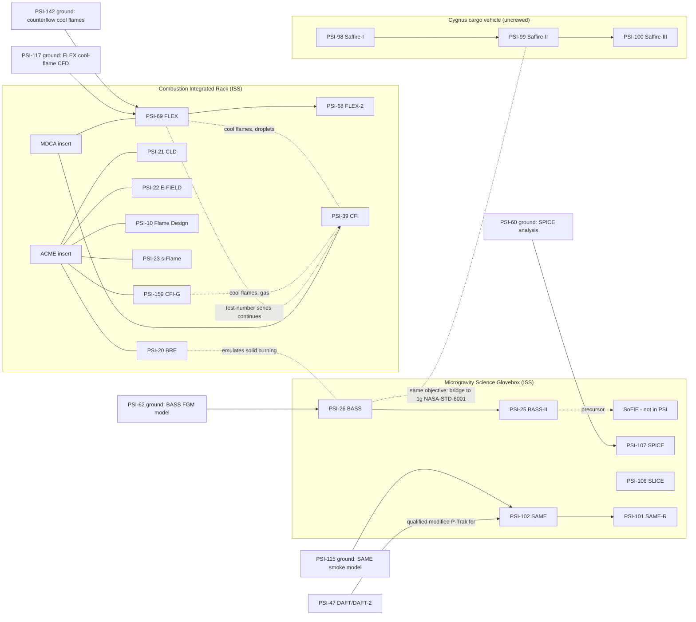

# FIREWISE — Scientific Analysis

> **Readiness audit 2026-11-13:** FLEX→CFI wording, CFI duplicates, ambient-O₂ counts and the gap statement are corrected. See `FINAL_READINESS_AUDIT.md` and `CHANGELOG.md`.

*Status: 2026-11-13. This analysis is built from the 24 PSI investigation records, the normalized
experimental tables (`derived/runs.csv`: 2,019 rows, 475 flags) and verified literature.*

**Evidence tags used throughout:**
- **[PSI-rec]** — wording in the PSI investigation record (`sources/psi_api/PSI-NN.json`)
- **[PSI-tab]** — computed from a PSI experimental table (`derived/runs.csv`)
- **[Lit]** — peer-reviewed or NASA literature, with a URL
- **[Inf]** — our inference; never presented as a result

---

## 1. Scientific problem map

| # | Question | Investigations with direct evidence | What the PSI evidence actually shows | Gap |
|---|---|---|---|---|
| 1 | How does µg change combustion vs 1g? | Saffire-II (paired µg/1g columns), BASS/BASS-II (objective: bridge to the NASA-STD-6001 1g test), CLD, SPICE, Flame Design | **[PSI-tab]** Saffire-II, 20 cm/s, ≈22% O₂: three silicone samples burned "~0" length in µg but **completely, with acceleratory spread, in 1g**. SIBAL burned the full 29 cm in µg at 2.1–2.6 mm/s concurrent spread. **[Lit]** CLD sooty µg flames are taller and wider with 5–8× more soot | Paired µg/1g data exist only for Saffire-II's 9 samples. Other 1g baselines live in publications |
| 2 | How does O₂ enrichment affect flammability? | FLEX (12–34% O₂), CFI-G (12–85%), Flame Design (20–85%), BRE (21–40%) | **[PSI-tab]** FLEX: at ≤15% O₂, all 22 methanol/N₂ tests ended in extinction; at >21%, heptane/N₂ tests mostly ended in disruption (10 of 11). **[PSI-rec]** BRE: "quasi-steady burning … observed in microgravity despite the absence of air flow … notably … in elevated-oxygen atmospheres" | **No real solid material burned above 23% O₂** in any PSI table (0 of 264 runs) |
| 3 | What evidence exists for spacecraft fire growth? | Saffire-I/II/III (large-scale, Cygnus), BASS/BASS-II (small-scale, ISS) | **[PSI-tab]** Saffire-I 94×40.6 cm SIBAL at 20 cm/s: concurrent burn 420 s vs opposed 70 s. **[Lit]** Saffire-I flame stayed limited in size and did not keep growing as in 1g (NTRS 20170008805) | Saffire-IV to VI (elevated O₂ and reduced pressure) are **not in PSI** |
| 4 | How do gas, liquid and solid fuels differ in µg? | ACME (gas), FLEX/FLEX-2/CFI (droplets), BASS/Saffire (solids) | Different geometries and diagnostics (§3) make direct cross-class comparison of rates invalid. The comparable quantity is the *limit* (extinction, flammability) as a function of O₂, P and flow | No common metric across classes. FIREWISE compares *conditions and outcomes*, not raw rates |
| 5 | How do airflow and pressure influence stability? | BASS (fan up to 40 cm/s), SPICE (coflow −5.9…85 cm/s), FLEX-2 (0.1–5 cm/s), FLEX/CFI/CFI-G (P 0.5–5 atm) | **[PSI-tab]** FLEX ran **103 tests at ≈0.7 atm**, 161 at ≈1 atm and 9 above 2.5 atm. CFI ran 0.5–5 atm. **[Lit]** SPICE smoke-point length ∝ d^-0.77 · u_coflow^0.48 (snippet only, unverified) | **Pressure is never documented for solids** |
| 6 | What do smoke/aerosol data reveal? | SAME, SAME-R, DAFT | **[PSI-rec]** Particle size changes in µg "will affect the response of the smoke detectors and possibly result in some detectors not producing an alarm". **[PSI-tab]** SAME-R ran 109 tests on 5 materials (Kapton 29, Silicone 22, Lampwick 20, Pyrell 20, Teflon 18) at 0–8.1 cm/s. **[Lit]** Mean diameters 100–200 nm; silicone mass mostly >1 µm | Smoke from *flaming* combustion is not covered; SAME/SAME-R heated materials without flaming |
| 7 | What is known about partial-gravity combustion? | none in PSI | **[PSI-tab]** 0 runs. **[Lit]** LUCI (New Shepard NS-29, 2025-02-04) achieved over 25 s of lunar g; parabolic flights reach 0.16 g / 0.38 g for ~24–33 s | Everything. See §6 |
| 8 | Which questions remain open for lack of data? | — | See §7 | — |

---

## 2. Investigation profiles

All ranges below are **tested conditions taken from the PSI tables [PSI-tab]**, not objectives.
"Missing" means the PSI table does not document the value; it does not mean the value was never measured.

### Gas-phase flames: ACME in the Combustion Integrated Rack (CIR)
| ID | Investigation | Fuels actually in table | Burner / geometry | O₂ % | P (atm) | Runs | Key result (tag) |
|---|---|---|---|---|---|---|---|
| PSI-20 | BRE (Burning Rate Emulator) | C₂H₄ (100%, 50%), CH₄ | porous flat burner 25 or 50 mm, **emulates a burning solid** | 21–40 (specified) | missing | 43 rows (18 days) | Quasi-steady burning without flow, especially at elevated O₂ [PSI-rec]; flames self-extinguish below ~25% O₂ [Lit] |
| PSI-21 | CLD Flame | CH₄ 40/100%, C₂H₄ 30/50/100% | coflow burner | missing | missing | 32 days | Sooty µg flames larger with 5–8× soot [Lit] |
| PSI-22 | E-FIELD Flames | CH₄, C₂H₄ (diluted and pure) | coflow then gas-jet burner; Cu mesh electrode up to 10 kV, both polarities [PSI-rec] | missing | missing | 21 days | Ion-current peak coincides with most compact flame [Lit] |
| PSI-10 | Flame Design | C₂H₄, C₃H₈; normal and inverse | porous sphere | 19.7–85.0 (measured/specified) | 0.43–3.03 (measured) | 327 | Hypothesis: µg spherical flames extinguish when peak T < 1130 K [PSI-rec] |
| PSI-159 | **CFI-G** | ethane, propane, butane (pure, 30%, 50% in N₂) | porous sphere | 12–85 | 0.49–3.27 (approx.) | 333 | **Cool flames: 7 tests, all 30% n-butane, X_O₂ ≈ 0.39, ≈2 bar** [PSI-tab], matching Kim et al. 2023 [Lit] |
| PSI-23 | s-Flame | H₂, CH₄, H₂/CH₄ blends, C₂H₄; N₂ then He dilution | porous sphere | ≈21 and ≈30 (reported, approximate) | ≈1 (table note) | 18 days | Radiative (high flow) and kinetic (low flow) extinction [Lit] |

### Liquid droplets: Multi-user Droplet Combustion Apparatus (MDCA) in the CIR
| ID | Investigation | Fuels | Geometry | O₂ % | P (atm) | Diluents | Runs | Key result |
|---|---|---|---|---|---|---|---|---|
| PSI-69 | **FLEX** | heptane (117), methanol (157) | free droplet, d₀ 1.1–4.67 mm (6 cells unreadable) | 12–34 (measured) | 0.69–3.05 (measured) | N₂, N₂+CO₂, N₂+He | 274 | **Measured** extinction diameter, burning rate, burn time; end mode extinction 186, disruption 61, completion 27 [PSI-tab]. Heptane cool flames after radiative extinction [Lit] |
| PSI-68 | FLEX-2 | 8 fuels/blends incl. iso-octane, n-octane, decane, ethanol, propanol/glycerol | droplet d₀ 1.5–5 mm | 17–30 (envelope) | 0.5–3 (envelope) | O₂/N₂ or O₂/He | 8 envelope rows | Envelope only; no per-test data in PSI |
| PSI-39 | CFI | n-dodecane, n-dodecane/iso-dodecane 60/40 and 75/25 | droplet, free or on SiC fiber [PSI-rec] | 17–21 | 0.5–5.0 | N₂, N₂+He | 87 rows (79 unique) | At 1 atm cool-flame burning ends in extinction at a finite size [Lit] |

### Solids and gas jets: Microgravity Science Glovebox (MSG) and Cygnus
| ID | Investigation | Materials / fuels | Geometry | O₂ % | Flow | Runs | Key result |
|---|---|---|---|---|---|---|---|
| PSI-26 | BASS | 34 sample descriptions incl. SIBAL, PMMA (slabs, 1–2 cm spheres), Nomex, Ultem, candles | flat sheets, spheres, slabs; Kanthal 29-gauge igniter; variable-speed fan up to 40 cm/s [PSI-rec] | missing | missing (fan) | 122 | Bridge to the 1g NASA-STD-6001 Test 1 [PSI-rec] |
| PSI-25 | BASS-II | 49 sample descriptions, mostly PMMA films 100–400 µm (1–2 cm wide), Nomex | films, rods, spheres, slabs | 0.6–22.2 initial (measured, N₂ vitiation) | fan-display units only | 129 | Flammability limits vs flow and O₂; precursor for SoFIE [PSI-rec] |
| PSI-98 | Saffire-I | SIBAL 0.37 cm, 94 × 40.6 cm | large sheet, Cygnus | 21.5–21.7 (reported) | 20 cm/s | 2 burns + 2 flow-vis | Concurrent 420 s vs opposed 70 s [PSI-tab] |
| PSI-99 | **Saffire-II** | silicone (×4 thicknesses), SIBAL ×2, PMMA ×2, PMMA+Nomex | 5 × 29 cm strips | ≈21.5–22.1 (**derived** from CO₂) | 20 cm/s | 9 burns + 2 flow-vis | **µg vs 1g contrast** (§1 Q1). Thick PMMA flames stayed anchored at the base, regression 0.01–0.04 mm/s [PSI-tab note] |
| PSI-100 | Saffire-III | SIBAL 0.33 cm, 94 × 40.6 cm | large sheet | missing | 30 cm/s | 2 | Concurrent vs opposed at higher flow |
| PSI-107 | SPICE | propylene (pure/75/50%), propane, ethylene, methane | coflow jet; nozzles 0.41/0.76/1.60 mm | missing | coflow −5.9 to 85 cm/s | 469 (34 duplicates) | Smoke-point properties of non-buoyant jet flames [PSI-rec] |
| PSI-106 | SLICE | CH₄ (20–100% in N₂), C₂H₄, C₂H₆ | **fan-driven flow duct, exchangeable burner tubes** [PSI-rec] | missing | missing | 12 dates | Lift-off velocity limits [PSI-rec] |

### Smoke and aerosol (MSG and ISS cabin)
| ID | Investigation | Sources | Instruments | Runs | Note |
|---|---|---|---|---|---|
| PSI-47 | DAFT / DAFT-2 | Arizona Road Dust (ARD Fine) in ISS GN₂ | **modified TSI P-Trak with alcohol wick** (D1); **DustTrak** control (D2) [PSI-tab] | 2 sessions (GMT 54 and 63, 2005) | **Purpose: de-risk the P-Trak for SAME** [PSI-rec] |
| PSI-102 | SAME | Teflon, Kapton, silicone rubber, lamp wick, dibutyl phthalate | P-Trak, smoke detectors, thermal precipitator → TEM [PSI-rec/Lit] | 8 table rows | TEM grids came back contaminated [PSI-rec, via PSI-101] |
| PSI-101 | SAME-R | Kapton, silicone, lamp wick, Pyrell, Teflon | same, plus a P-Trak condenser-tube modification drawing [PSI file list] | 109 | Re-flight to recover particle-size data |

---

## 3. Cross-investigation comparisons (the brief's A–E)

### A. SAME ↔ DAFT. Correcting the brief's assumption
The brief assumed the SAME smoke instrument was *later* adapted for DAFT dust measurements. **The PSI record says
the opposite [PSI-rec, PSI-47]:**
> "The focus of DAFT / DAFT-2 was to mitigate the risk for the Smoke Aerosol Measurement Experiment (SAME). SAME
> relied on a commercially available condensate nuclei counter, the TSI P-Trak … there were concerns that the
> P-Trak would not be reliable in microgravity as it relies on gravity to recycle isopropyl alcohol …"

| Aspect | DAFT / DAFT-2 | SAME / SAME-R |
|---|---|---|
| Role | Feasibility test of the instrument | Science: smoke particle size vs generation and transport conditions |
| When | 2005 (GMT 54 and 63) [PSI-tab] | SAME: ISS Expedition 15, 2007 [Lit]. SAME-R: Jul–Sep 2010 [PSI-rec] |
| Shared instrument | TSI P-Trak condensation particle counter, **modified with an alcohol wick** | the same P-Trak family; SAME-R adds a condenser-tube modification (drawing in PSI-101) |
| Control instrument | TSI DustTrak (photometric) | multiple aerosol instruments plus spacecraft smoke detectors [Lit] |
| Particles | Arizona Road Dust, mineral, not combustion | pyrolysis smoke from 5 heated materials, liquid droplets |
| Limitation | 2 sessions; dust ≠ smoke | heated, non-flaming sources; TEM grid contamination in SAME |

**Do not compare DAFT particle counts with SAME smoke counts as equivalent aerosols. The link is
instrument qualification, not shared science.**

### B. ACME family: shared hardware, different science
- **Shared [PSI-rec/Lit]:**
  - the CIR chamber (~100 L, constant volume)
  - ACME mass-flow controllers and the retracting resistive igniter
  - the 12-bit 1360×1024 colour camera, matching the local CFI-G frames
  - the full ACME drawing set, filed under PSI-23 "Engineering Documents" (burners, cameras, diagnostics, igniter)
  - radiometers, the thermocouple rake and gas chromatography
- **Not shared:** burner geometry differs across the family:
  - flat porous (BRE)
  - coflow (CLD, E-FIELD)
  - gas-jet (E-FIELD second round)
  - spherical porous (Flame Design, s-Flame, CFI-G)
- **BRE is the outlier.** Its purpose is to **emulate the burning of a solid surface** (a heat-flux-instrumented
  flat burner in quiescent ambient). All the others study gas-flame physics: soot, ion currents, cool-flame
  kinetics. E-FIELD says
  explicitly that it "is not being conducted to serve any space applications" [PSI-rec]. BRE's stated impact
  centres on spacecraft fire safety [PSI-rec].
- **Comparable across ACME:** O₂, pressure, diluent and T_ad, which Flame Design and CFI-G tables share
  (`XO2`, `p`, `Tad`, `Zst`). **Not comparable:** flame size or soot across different burner geometries.

### C. FLEX ↔ FLEX-2 ↔ CFI: one apparatus, one test-number series
- **Shared:** MDCA in the CIR; free or fiber-supported droplets; hot-wire ignition.
- **[PSI-tab] CFI test IDs are a "Flex Number" series (1206–1387), while FLEX tests are 1–274.** [Inf] This is consistent with one MDCA numbering series; numbers 275–1205 are undocumented in PSI. This is suggestive, not proof, that CFI continued the FLEX hardware
  campaign.

| | FLEX | FLEX-2 | CFI |
|---|---|---|---|
| Purpose | Flammability limits and **gaseous suppressants** (CO₂, He; SF₆ listed in objective) | Bi-component and real-fuel droplets, convection 0.1–5 cm/s | Cool flames of n-dodecane and blends, 0.5–5 atm, He dilution |
| Fuels | heptane, methanol | 8 fuels/blends | n-dodecane, dodecane/iso-dodecane |
| Distinct data | measured extinction diameter and end mode | envelope only | pressure and He variation |

- Methanol cool flames do not appear in FLEX's literature; heptane cool flames do [Lit, Inf].
- FLEX is the natural **suppression** dataset: CO₂ vs He diluent at the same O₂.

### D. BASS / BASS-II / SPICE / SLICE: MSG flow-duct family
- **Verified [PSI-rec]:**
  - BASS: MSG, variable-speed fan up to 40 cm/s, Kanthal igniter
  - SPICE: MSG, "flow duct with integrated nozzles, cameras, and fuel delivery"
  - SLICE: "fan-driven flow duct, exchangeable burner tubes, and integrated sensors"
  - BASS-II: MSG, forced flow, O₂ by nitrogen vitiation
- **Unverified:** that all four used the *same physical duct*. Mark it as plausible and check against the
  BASS/SPICE reports in `sources/psi_files/`.
- **Contrast:** BASS and BASS-II burn **solids** (opposed and concurrent spread). SPICE and SLICE burn **gas
  jets** (smoke point, lift-off). Shared variable: coflow velocity. The physics compared differs: spread rate
  vs smoke-point length.

### E. Saffire I–III: scale-up of solid-fire evidence
- Saffire is the **only large-scale** evidence (94 × 40.6 cm sheets, Cygnus cabin-scale volume, uncrewed).
- I → III move from flow 20 → 30 cm/s and from one material (SIBAL) to a multi-material, thickness-varied
  series (II).
- **Saffire-II is the only investigation with paired µg/1g outcome columns.**
- The PSI table O₂ values are *derived*, and no pressure is documented.

### Investigations that should **not** be compared directly
- DAFT dust vs SAME smoke: different particles.
- BRE emulated "burning rate" vs BASS/Saffire spread rates: gas burner vs real solid.
- Flame Design/CFI-G inverse flames vs normal flames: oxidizer and fuel roles are swapped.
- Any SPICE flow value vs BASS fan settings: cm/s vs display units.

---

## 4. Relationship map

---

## 5. Comparison matrix (shared dimensions)
| Dimension | Values across PSI combustion investigations | Comparable? |
|---|---|---|
| Gravity | all flight runs µg. 1g only as Saffire-II comparison columns and in publications. Partial g: none | yes (but trivially, all µg) |
| O₂ | documented for 1,219 of 2,007 records; **956 are ambient** (274 inverse-flame rows give burner-stream O₂, not atmosphere); 12–85% | yes, where documented. Statuses differ (measured / specified / derived) |
| Pressure | documented for 1,046 runs, gas and droplet only; 0.43–5 atm | **not for solids** |
| Flow | quiescent (ACME, MDCA), 0.1–5 cm/s (FLEX-2), 20–30 cm/s (Saffire), −6…85 cm/s (SPICE), fan units (BASS-II) | partially; units differ |
| Fuel class | gas 1,212 · droplet 369 · solid 264 · solid-emulator 43 · smoke source 117 · dust 2 runs | within class only |
| Facility | CIR/ACME (6), CIR/MDCA (3), MSG (6), Cygnus (3), ISS cabin (1) | hardware similarity ≠ scientific similarity |

---

## 6. Partial gravity: what can and cannot be said
- **Verified:**
  - **0** partial-g runs among 2,007 PSI runs [PSI-tab]; the challenge text agrees.
  - **LUCI** flew on New Shepard NS-29 (2025-02-04). It spun to lunar g for over 25 s and burned cotton-fiberglass
    fabric and a 4 mm PMMA rod; falling O₂ gave a limiting-O₂ value (NTRS 20250010653) [Lit]. Its data are
    **not in PSI**.
  - **FM2** is planned for CLPS CP-21 in late 2026: 4 solid samples in quiescent air, at 21% / 14.7 psia and
    34% / 8.2 psia (NTRS 20240015307; LPSC 2026 abstract). Launch status is unverified [Lit].
  - Other partial-g sources are short: drop-tower centrifuge (Ferkul & Olson 2011) and parabolic flights at
    0.16/0.38 g for ~24–33 s (CNES, PCI 39) [Lit].
- **Defensible use of µg + 1g data:**
  - *Bracketing* (the challenge's word: "bound"): show the µg value and the 1g value side by side
    (Saffire-II) and label partial g "unmeasured".
  - Physically, buoyant flow scales with √(g·L). For a given sample length, lunar g gives buoyant velocities
    ≈ √0.165 ≈ 0.41 of 1g [Inf, textbook scaling]. This is useful for *choosing which µg forced-flow tests are
    analogous*, not for prediction.
- **Not defensible:**
  - interpolating spread rates or extinction limits between µg and 1g
  - any "lunar fire risk score"
  - presenting E-FIELD's ion-driven flow as partial-g evidence. The challenge page mentions it, but the PSI-22
    record text does not, so it stays [Lit-to-verify].

---

## 7. Research gaps (data-driven, from `derived/coverage.csv`)
1. **Solids in exploration atmospheres.** 0 of 264 solid runs document pressure, and 0 exceed 23% O₂. The
   relevant data are either outside PSI (Saffire-IV to VI, FM2) or in publications only.
2. **Pressure for all MSG and Cygnus experiments** is undocumented in the tables.
3. **Partial gravity:** no PSI data; LUCI data are not deposited.
4. **Flaming-smoke aerosols:** SAME/SAME-R cover non-flaming pyrolysis smoke only.
5. **Raw data not enumerated** for FLEX, FLEX-2, BRE, CLD, E-FIELD, Saffire-II and SLICE (17 GB–2 TB each by
   `totalFileSize`).
6. **Suppression:** only FLEX (CO₂, He diluents) addresses agents. No water-mist or other agents in PSI.
7. **Unexplored combinations:** no run documents ambient 30–36% O₂ at 8.2–10.2 psia. The nearest are FLEX droplets at
   10.3–10.5 psia (17) and CFI-G gas flames at ≈7.35 psia (10); solids
   0. The obvious next test matrix is the same O₂/P grid for thin and thick solids at 0–30 cm/s, which is what
   FM2 and the Saffire successors target.

---

## 8. Predictive-modeling feasibility (honest)
| Target | Data | Verdict |
|---|---|---|
| FLEX test end (extinction / disruption / completion) from fuel, diluent, O₂, P, d₀ | 274 tests (1 missing P, 6 unreadable d₀), 2 fuels | **Feasible as a transparent, single-investigation model** (logistic regression or shallow tree, grouped cross-validation by test day). Valid only inside FLEX's envelope. P1 at best |
| FLEX extinction diameter | 159 extinction tests | Feasible for exploratory regression. Unit of "burning rate" still to verify |
| CFI-G cool-flame occurrence | 7 positives, 171 unlabeled | **Not feasible.** Too few positives; blanks ≠ negatives |
| Solid flame spread, fire growth | Saffire 13 burns; BASS without conditions | **Not feasible.** Descriptive only |
| Anything at partial g | 0 runs | **Out of scope; no claims** |
| Cross-investigation "flammability score" | heterogeneous metrics | **Not defensible.** Use evidence coverage instead |

---

## 9. Open items to verify next
- Burning-rate unit in the FLEX table (NASA/TP-2015-216046).
- Whether BASS, SPICE and SLICE shared one physical duct (BASS final report in PSI-26 documents).
- SAME-R `Rt/R0` column meaning (likely a detector or precipitator ratio; unknown until the report is read).
- Whether E-FIELD "mimicked partial gravity": a challenge-page claim, not in the PSI-22 record.
