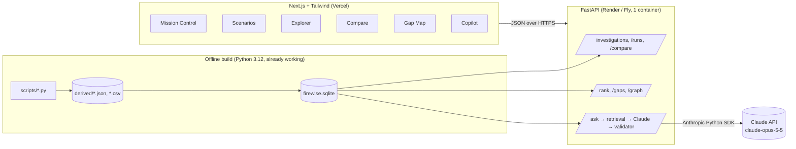

# FIREWISE — Technical Architecture

> **Readiness audit 2026-11-13:** The API table (§3) and the streamed `/ask` are superseded by `FINAL_API_CONTRACT.md`. Python dependencies are not installed yet (`KICKOFF_CHECKLIST.md` §2). See `FINAL_READINESS_AUDIT.md` and `CHANGELOG.md`.

**Constraint:** 2–3 developers, 48 hours, and a demo that cannot fail. **Rule:** every P0 screen works from
precomputed data with the LLM switched off. The Copilot is the only live-LLM feature, and it has a cached
fallback for the demo questions.

---

## 1. System


---

## 2. Technology decisions
| Decision | Choice | Why needed | Alternatives (rejected) | Complexity | Needed for MVP? |
|---|---|---|---|---|---|
| Data processing | Python 3.12, stdlib + pandas (optional) | normalizers already written in stdlib | R, notebooks | low | yes (done) |
| Store | **SQLite + FTS5** | single file, BM25 full-text, ships with the API | Postgres (ops), Chroma/FAISS (no need yet) | low | yes |
| Backend | **FastAPI** | typed JSON endpoints, async streaming for `/ask` | Flask, Next.js API routes (keep Python with the data) | low | yes |
| Graph | **NetworkX** at startup | builds edges from SQL in milliseconds | Neo4j (hosting, no query need) | low | P1 |
| Frontend | **Next.js (App Router) + TypeScript + Tailwind** | fast to build, Vercel deploy | plain React + Vite (fine too) | medium | yes |
| Charts | **Plotly.js** (react-plotly) for scatter, heatmap and bars | interactive hover with source info | D3 (slower to build) | low | yes |
| Graph view | **Cytoscape.js** | typed nodes, layouts | D3 force | low | P1 |
| LLM | **Claude API, Python `anthropic` SDK**, `claude-opus-5-5`, adaptive thinking, effort `medium` (Q&A) / `low` (routing), structured outputs via `output_config.format`, streaming, prompt caching on the static prefix, server-side refusal fallback | grounded explanation with citations | fine-tuning or training (explicitly excluded) | medium | yes (Copilot) |
| Embeddings | none in P0 | BM25 + SQL filters cover a 24-investigation corpus | add only if recall@5 < 0.8 | — | no |
| Deploy | Vercel (web) + Render (API, Docker); fallback: one Docker image serving both | free tiers, quick | Kubernetes, AWS | low | yes |

---

## 3. API contract (P0)
| Method | Path | Returns |
|---|---|---|
| GET | `/api/summary` | counts, coverage summary, data classes |
| GET | `/api/investigations?fuel_class=&facility=&o2_min=&o2_max=&p_min=&p_max=&q=` | list of cards |
| GET | `/api/investigations/{id}` | full record (verbatim text, ranges with statuses, pubs, files, flags, facts) |
| GET | `/api/investigations/{id}/runs?changed_only=true` | run table + which columns vary |
| GET | `/api/compare?ids=PSI-26,PSI-100` | shared/different/missing features, per-feature similarity, incompatibility flags |
| GET | `/api/rank?scenario=moon_base` or `?o2=34&p_psia=8.2&g=lunar&flow_min=0&flow_max=20` | ranked list with score components |
| GET | `/api/gaps?dims=gravity,fuel_class,o2_band,p_band` | coverage cells + literature overlays |
| GET | `/api/graph?focus=PSI-47` | nodes and edges (P1) |
| POST | `/api/ask` `{question, scenario?}` | streamed JSON: claims[] with evidence_ids, tiers, limitations, gaps, sources[] |
| GET | `/api/evidence/{evidence_id}` | resolves a citation to text + URL/file/row/page |

All responses carry `build` metadata (git sha, build time, n_runs).

---

## 4. Repository layout (to create at hackathon start)
```
NasaSA/
  Data/            # originals (read-only)
  sources/         # immutable downloads + sources.csv
  derived/         # regenerable data products (committed)
  scripts/         # pipeline (done) + load_db.py (P0)
  api/             # FastAPI app: main.py, db.py, rank.py, similarity.py, gaps.py, ask.py, evidence.py
  web/             # Next.js app
  docs/            # the 10 deliverables
  tests/           # pytest: normalizers, rank, similarity, citation validator; validation-set runner
```
Git: initialise at the start of the hackathon. Commit `derived/` (small); add `sources/psi_files` and `Data/` to
`.gitignore` (large).

---

## 5. `/ask` request flow (deterministic plus LLM)
1. **Route:** a keyword and regex router covers the canonical intents (rank, compare, shared hardware, partial g,
   conditions). It falls back to an LLM call at effort `low` that returns `{intent, investigations[], filters}`
   via structured output.
2. **Assemble evidence** (≤ 40 items, ≤ 12k tokens):
   - SQL results summarized as evidence rows
   - FTS5 top-k passages
   - relevant curated facts
   - coverage cells
3. **Answer:** one Claude call. A system prompt (frozen and cached) states the evidence-tier rules and the
   output schema; the evidence pack comes after the cache breakpoint.
4. **Validate:** every `evidence_id` resolves and belongs to the pack. Numbers in claim text must appear in the
   cited items. Tier rules are respected. Failure means one retry, then strip the failing claims and add a
   limitation note.
5. **Stream** to the UI; citations render as chips.
6. **Demo safety:** the answers to the 6 scripted demo questions are precomputed and validated, and served if the
   API is slow or unavailable, with a "cached answer" label.

---

## 6. Performance and reliability
- Data is about 10 MB SQLite, held in memory. P95 under 100 ms for non-LLM endpoints.
- No live PSI calls at runtime; everything is pre-harvested.
- Single-container fallback: `docker run` serves both the API and the static Next export on a laptop if
  hosting fails.
- Secrets: `ANTHROPIC_API_KEY` only in API environment variables; never in the frontend or the repo.
